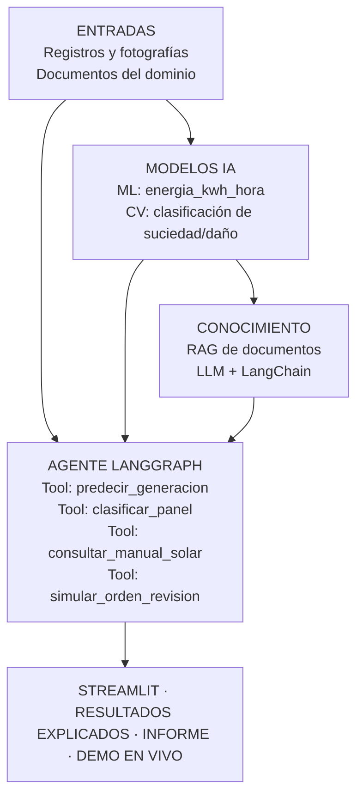

# DESIGN.md — SolarGuard AI

> **Sistema inteligente para inspección visual y pronóstico de producción fotovoltaica**

---

## Información general del proyecto

| Campo | Detalle |
| :--- | :--- |
| **Institución** | Universidad Nacional de Trujillo — Facultad de Ingeniería · Escuela de Ingeniería de Sistemas |
| **Proyecto** | Proyecto Final Integrador · Grupo 08 — **SolarGuard AI** |
| **Curso** | Sistemas Inteligentes — VI ciclo |
| **Área** | Energías renovables / mantenimiento |
| **Modalidad** | Grupal · prototipo funcional para feria de proyectos |
| **Semestre** | 2026-II (Trujillo · Semestre académico 2026-II) |
| **Enfoque** | ML + Deep Learning/CV + LLM + LangChain + RAG + LangGraph + Streamlit |
| **Propósito del documento fuente** | Material para asignación, desarrollo, evaluación y sustentación |

### Consigna de trabajo
Desarrollar un sistema inteligente original, documentado, medible y demostrable. Las tecnologías deben colaborar en una decisión verificable; no se aceptan módulos aislados ni resultados fabricados.

---

## 1. Planteamiento del proyecto

| Elemento | Definición específica |
| :--- | :--- |
| **Problema identificado** | La generación solar depende de condiciones ambientales y los fallos visuales requieren inspección técnica que suele no estar integrada con métricas de producción. |
| **Pregunta guía** | ¿Cómo relacionar pronósticos de generación e inspección visual para identificar paneles que merecen revisión? |
| **Usuarios y beneficiarios** | Operadores de instalaciones fotovoltaicas y técnicos de mantenimiento. |
| **Decisión asistida** | Recomendar inspecciones técnicas orientadas por discrepancias de generación. |
| **Aporte innovador** | Comparar energía esperada, observada y hallazgos en imágenes, con apoyo de manuales técnicos citados. |
| **Alcance y exclusiones** | No inferir fallos internos de paneles sin medición adecuada; termografía se incorpora sólo con cámara y datos térmicos disponibles. |

### 1.1 Introducción y justificación del informe
El equipo deberá escribir una introducción que explique la realidad problemática, sus causas, las consecuencias operativas y por qué una solución híbrida aporta valor frente a una práctica manual. Usar al menos un indicador del problema sustentado en datos o literatura verificable. No presentar hipótesis, normas o resultados como hechos sin fuente.

### 1.2 Antecedentes científicos exigidos
Reunir al menos cinco publicaciones académicas pertinentes; elaborar una matriz con referencia verificable, problema, datos, modelo, evaluación, limitación y oportunidad de mejora. Recomendación: cubrir estudios del sector, modelos tabulares, visión artificial y sistemas RAG/agentes. Distinguir antecedentes realmente encontrados de propuestas propias.

---

## 2. Objetivos de investigación y desarrollo

### Objetivo general
Diseñar, implementar y evaluar un sistema inteligente integrado para recomendar inspecciones técnicas orientadas por discrepancias de generación en el contexto de energías renovables / mantenimiento, utilizando ML, visión computacional y un asistente fundamentado en documentos con RAG y LangGraph.

### Objetivos específicos
1. Caracterizar la problemática y establecer requerimientos, usuarios, restricciones y métricas de aceptación medibles.
2. Obtener y preparar datos representativos para regresión de generación eléctrica; construir un baseline y comparar al menos dos modelos candidatos.
3. Preparar, etiquetar o auditar imágenes; desarrollar el componente de visión para clasificación de suciedad o daño físico visible en paneles mediante fotografías RGB y medir su generalización.
4. Implementar un asistente con LLM y LangChain que produzca respuestas estructuradas y evidencie sus límites.
5. Construir un RAG verificable con documentos del dominio, citas de fragmentos y pruebas de recuperación.
6. Orquestar con LangGraph herramientas reales de predicción, análisis visual y búsqueda, incluyendo intervención humana.
7. Integrar y validar el prototipo Streamlit en escenarios de feria, analizar errores y formular recomendaciones sustentadas.

---

## 3. Requerimientos y usuarios

| Tipo | Especificación y evidencia |
| :--- | :--- |
| **Funcional 1** | Formulario de datos tabulares con validación de rangos, unidades y valores faltantes. |
| **Funcional 2** | Carga de imagen y visualización del resultado de visión con confianza y casos «no evaluable». |
| **Funcional 3** | Chatbot contextual que responde consultas sobre el resultado con fuentes recuperadas. |
| **Funcional 4** | Agente con herramientas observables, trazas por nodo y emisión de reporte descargable. |
| **No funcional** | Interfaz comprensible, tiempos medidos, tratamiento de errores, logging, separación de secretos y pruebas automatizadas. |
| **Decisión humana** | No ejecutar desconexiones ni mantenimiento eléctrico automatizado. |

---

## 4. Datos y enfoque experimental

| Conjunto | Exigencia concreta |
| :--- | :--- |
| **Dataset tabular** | Series temporales piloto de medidores e información meteorológica con licencias claras. |
| **Dataset de imágenes** | Fotografías autorizadas de instalaciones o datasets públicos de inspección. |
| **Variables de entrada** | Irradiancia, temperatura ambiente, temperatura de módulo, nubosidad, hora, estación, capacidad instalada e histórico. |
| **Objetivo ML** | `energia_kwh_hora` |
| **Etiquetas CV** | `panel limpio`, `suciedad visible`, `grieta visible` y `vista no evaluable`; termografía opcional. |
| **Volumen y alcance** | Meta orientativa: `>= 500` observaciones horarias y `>= 350` imágenes, con trazabilidad de instalación. |
| **Separación ML** | Separación temporal por días/estaciones, evitando fuga desde variables medidas después del instante predicho. |
| **Separación visión** | Separar por panel o instalación y sesión de captura. |

**Documentación y transparencia de datos:**
- Documentar procedencia, fecha, permisos/licencias, diccionario, criterios de exclusión, valores faltantes, balance de clases y sesgos.
- Las cantidades son metas de planificación, no evidencia de disponibilidad. Si no existen datos reales suficientes, presentar de forma transparente la limitación y evaluar el alcance de una demostración controlada.

### 4.1 Machine Learning: implementación exigida
- **Tarea:** Regresión de generación eléctrica. Variable objetivo: `energia_kwh_hora`.
- **Baseline:** Regresión lineal con irradiancia y capacidad nominal. Modelos comparables: `RandomForestRegressor` y `GradientBoostingRegressor`.
- **Diseño de validación:** Separación temporal por días/estaciones, evitando fuga desde variables medidas después del instante predicho. Selección de hiperparámetros usando validación cruzada compatible con datos agrupados/temporales y test final intacto.
- **Métricas:** MAE (kWh), RMSE y error normalizado por capacidad. Entregar tabla entrenamiento/validación/prueba, análisis por subgrupo y gráficos de errores.
- **Preprocesamiento:** Implementar `Pipeline`/`ColumnTransformer` cuando corresponda; evitar imputación, escalado o codificación antes de dividir los datos.

### 4.2 Visión computacional: implementación exigida
- **Problema visual:** Clasificación de suciedad o daño físico visible en paneles mediante fotografías RGB. Categorías previstas: `panel limpio`, `suciedad visible`, `grieta visible` y `vista no evaluable`; termografía opcional.
- **Arquitecturas candidatas:** `MobileNetV3`/`EfficientNet` con transfer learning; `YOLO` para localizar daño si hay cajas. Comparar con una referencia sencilla o modelo sin ajuste.
- **Etiquetado:** Etiquetas revisadas por técnico; distinguir polvo/sombra/reflectancia.
- **Prueba libre de fugas:** Separar por panel o instalación y sesión de captura.
- **Métricas:** macro-F1 y recall de daños; mAP si localización. Añadir imágenes bien clasificadas, errores y casos difíciles con explicación.

---

## 5. LLM, LangChain y chatbot

Construir un chatbot mediante Streamlit. El LLM debe explicar los resultados computados, diferenciar hechos inferidos de documentos y formular preguntas de aclaración cuando faltan datos. LangChain debe integrar plantillas, modelo, herramientas y salidas estructuradas validadas (por ejemplo, mediante Pydantic).

### Instrucción de sistema (a adaptar por el equipo)
> «Eres un asistente de Energías renovables / mantenimiento. No inventes resultados, procedimientos o referencias; distingue predicción estadística, hallazgo visual y evidencia textual. Si no existen fuentes pertinentes, declara que no hay respaldo documental. No inferir fallos internos de paneles sin medición adecuada; termografía se incorpora sólo con cámara y datos térmicos disponibles.»

### Contrato de salida sugerido
```json
{
  "panel": "...",
  "energia_esperada": "...",
  "desviacion": "...",
  "condicion_visual": "...",
  "pasos_revision": ["..."],
  "citas": ["..."]
}
```

### 5.1 RAG y gestión documental
- **Corpus propuesto:** Manuales del inversor/panel, planes de mantenimiento y guías de inspección fotovoltaica.
- **Pregunta de prueba ejemplo:** *¿Qué controles manuales se recomiendan ante baja generación y suciedad visible?*
- **Pipeline:**
  `extraer texto y metadatos` → `limpiar` → `segmentar con identificador y página` → `embeddings` → `índice vectorial` → `recuperar top-k` → `reranking opcional` → `respuesta con citas y advertencia si no hay evidencia`.
- **Evaluación:** Comparar respuesta sin recuperación versus con RAG en al menos 20 consultas de evaluación redactadas con respuestas/documentos de referencia; registrar recuperación relevante, fidelidad, cobertura y citas correctas.
- **Seguridad documental:** Probar rechazo de instrucciones maliciosas incrustadas en documentos; el contenido recuperado es fuente de datos, no instrucciones al sistema.

### 5.2 Agente con LangGraph
El grafo debe guardar **estado tipado**:
- Solicitud
- Predicciones
- Hallazgos
- Fragmentos recuperados
- Herramientas invocadas
- Nivel de incertidumbre
- Decisión/aprobación
- Errores

Construir nodos explícitos y rutas condicionales con registro de traza.

**Ruta sugerida:**
```text
obtener_mediciones → predecir_energia → comparar_observado → analizar_foto → buscar_manual → proponer_revision → validar_tecnico
```

**Herramientas mínimas funcionales** (se deben programar, no describir solamente):
- `predecir_generacion(fecha, condiciones)`
- `clasificar_panel(ruta_imagen)`
- `consultar_manual_solar(consulta)`
- `simular_orden_revision(panel)`

**Control humano y manejo de errores:**
- No ejecutar desconexiones ni mantenimiento eléctrico automatizado.
- Agregar condición de parada por incertidumbre.
- Incluir rutas de error para archivos no válidos, modelo sin cargar, falta de documentos y fallos de API.

---

## 6. Arquitectura integrada y flujo de datos

Los módulos se personalizan con las variables, modelos, herramientas y políticas del grupo:



### Secuencia obligatoria
1. Usuario envía datos e imagen.
2. Validar entradas.
3. Consultar modelo tabular.
4. Ejecutar visión.
5. Buscar evidencia documental contextualizada.
6. LangGraph decide llamadas a herramientas y comprueba restricciones.
7. El LLM redacta una respuesta trazable.
8. Streamlit presenta métricas, advertencias y reporte.

### 6.1 Estructura sugerida del repositorio
```text
app.py
src/
├── data/
├── ml/
├── vision/
├── rag/
├── agents/
└── ui/
tests/
notebooks/
docs/
configs/
README.md
.env.example
```

---

## 7. Metodología de ejecución (CRISP-DM + ingeniería de software)

| Fase | Actividades y evidencia |
| :--- | :--- |
| **1. Comprensión del negocio** | Definir el proceso real, variable de decisión, usuario, alcance y costo de error. Entregar mapa del proceso y requerimientos. |
| **2. Comprensión de datos** | Auditar registros e imágenes, licencias, calidad, etiquetas, cobertura y sesgos. Entregar EDA y fichas de dataset. |
| **3. Preparación** | Desduplicar, imputar dentro del pipeline, establecer splits de grupo/tiempo, preparar anotaciones de imágenes. Entregar scripts reproducibles. |
| **4. Modelado** | Entrenar baseline y dos candidatos ML; adaptar modelo visual preentrenado; ajustar hiperparámetros con validación adecuada. |
| **5. Evaluación** | Comparar modelos en test separado, medir errores y subgrupos; validar RAG con preguntas de referencia y agente con tareas de prueba. |
| **6. Integración y despliegue** | Conectar predicción, imagen, retrieval, LangGraph y chat en Streamlit; documentar dependencias, pruebas y modo demo. |

---

## 8. Matriz de pruebas y métricas

| Módulo | Protocolo mínimo | Indicadores |
| :--- | :--- | :--- |
| **ML** | Comparación baseline / modelo A / modelo B con mismo test | MAE (kWh), RMSE y error normalizado por capacidad |
| **Visión** | Conjunto de prueba disjunto con matrices y errores comentados | macro-F1 y recall de daños; mAP si localización |
| **RAG** | Preguntas contestables, sin respaldo y adversariales | Recall@k / Hit@k, fidelidad, exactitud de cita |
| **Agente** | Pruebas de herramientas, rutas condicionales, error y aprobación | Tareas correctas / total, fallos, trazas y control humano |
| **Sistema** | Tres escenarios completos, fallo de API, sin internet y entrada inválida | Tiempo de respuesta, éxito funcional y evidencia de logs |

> **Regla importante:** No declarar un umbral de *accuracy* como garantía de calidad. Definir metas justificadas y contrastarlas con resultados reales, distribución de clases, riesgos y costos de error.

---

## 9. Tres escenarios obligatorios para la feria

### Escenario 1
- **Objetivo:** Pronosticar generación para un día con irradiancia de prueba.
- **Evidencia observable:** Datos de entrada, llamada a herramientas y nodos, predicción, incertidumbre, fragmentos RAG con fuente, resultado en pantalla y registro de prueba.

### Escenario 2
- **Objetivo:** Mostrar fotografía con suciedad o daño visible y obtener predicción visual.
- **Evidencia observable:** Datos de entrada, llamada a herramientas y nodos, predicción, incertidumbre, fragmentos RAG con fuente, resultado en pantalla y registro de prueba.

### Escenario 3
- **Objetivo:** Comparar energía real/estimada y obtener plan de revisión con respaldo documental.
- **Evidencia observable:** Datos de entrada, llamada a herramientas y nodos, predicción, incertidumbre, fragmentos RAG con fuente, resultado en pantalla y registro de prueba.

### 9.1 Guion de demostración técnica
1. Abrir Streamlit y confirmar modelos cargados.
2. Demostrar primero la ruta normal.
3. Luego demostrar una entrada difícil.
4. Finalmente demostrar una consulta sin fuente.
5. Mostrar trazas LangGraph y resultado de la validación humana.
6. Incluir vídeo de respaldo de 3–5 minutos y modo offline cuando sea factible.

---

## 10. Riesgos, seguridad y contingencia

| Riesgo | Acción preventiva y plan de contingencia |
| :--- | :--- |
| **Riesgo principal** | Confundir sombra con defecto, variaciones meteorológicas y falta de datos térmicos. |
| **Plan alternativo** | Centrar visión en suciedad RGB y considerar la termografía un alcance opcional no obligatorio. |
| **Privacidad y ética** | No inferir fallos internos de paneles sin medición adecuada; termografía se incorpora sólo con cámara y datos térmicos disponibles. |
| **Alucinaciones y prompt injection** | Citas verificables, validación de datos estructurados, corpus de confianza y prohibición de ejecutar instrucciones recuperadas. |
| **Servicios externos** | Caché de ejemplos autorizados, datasets de demo local, manejo de cuotas, archivo `.env.example` y fallback claro. |
| **Reproducibilidad** | Fijar semillas y versiones, almacenar particiones, guardar modelos, no publicar secretos ni datos restringidos. |

---

## 11. Contenido del informe académico final

- **Preliminares:** Carátula UNT, integrantes y responsabilidades; resumen/abstract (150–250 palabras), palabras clave e índices. El resumen se redacta al finalizar e incluye problema, método, evidencia y principales resultados medidos.
- **I. Introducción:** Contexto del sector, realidad problemática con datos sustentados, pregunta de investigación, justificación, alcance, población de uso, delimitaciones y riesgos.
- **II. Antecedentes y bases teóricas:** Mínimo cinco trabajos científicos verificables; matriz comparativa (autor/año, dataset, técnicas, métricas, brechas) y fundamentos de ML, visión, Transformers/LLM, LangChain, RAG, LangGraph, evaluación e IA responsable.
- **III. Objetivos:** Objetivo general y objetivos específicos expresados mediante resultados observables, alineados con métricas y módulos.
- **IV. Metodología:** CRISP-DM complementado con iteraciones de software: obtención y licencia de datos, EDA, transformaciones, partición, modelos, evaluación, arquitectura, RAG, agentes, pruebas, ética.
- **V. Implementación:** Entorno reproducible, estructura de paquetes, API o modelos locales, interfaz Streamlit, captura de pantallas, persistencia, registro de errores, configuración y diagrama.
- **VI. Resultados y discusión:** Tablas reales de modelos comparados, resultados CV, evaluación retrieval/RAG, pruebas del agente, sistema integral, errores frecuentes, pruebas negativas, discusión de hallazgos y limitaciones.
- **VII. Conclusiones:** Una conclusión por objetivo específico, basada en evidencia real; especificar qué funcionó, qué no, condiciones de validez y sin cifras inventadas.
- **VIII. Recomendaciones:** Mejoras de datos, evaluación externa, optimización, interfaz, privacidad, despliegue y trabajo futuro realista.
- **Referencias y anexos:** Bibliografía APA 7 con URL/DOI verificables; diagramas, instrumentos, diccionario de datos, fichas de modelos, manual, README, capturas, pruebas, consentimiento y enlaces a repositorio.

### 11.1 Orientación concreta para redactar conclusiones
El capítulo de conclusiones debe responder:
1. **(a)** ¿Qué modelo resultó mejor en test y bajo qué métrica?
2. **(b)** ¿Qué tipos de imágenes clasificó incorrectamente?
3. **(c)** ¿Cuántas preguntas RAG se sustentaron en documentos y dónde falló?
4. **(d)** ¿Qué tareas completó el agente sin infringir controles?
5. **(e)** ¿Hasta qué punto el sistema apoya recomendar inspecciones técnicas orientadas por discrepancias de generación?

> Evitar frases sin evidencia como «el sistema tiene una precisión excelente».

---

## 12. Entregables y criterios de aceptación

| Entregable | Evidencia mínima esperada |
| :--- | :--- |
| **Informe Word editable** | Capítulos I–VIII, APA 7, tablas de métricas, limitaciones y anexos. Evidencia de qué estudiante redactó/revisó cada parte. |
| **Repositorio de código** | README con arquitectura, scripts de ejecución, carpetas `src`/`tests`/`notebooks`/`data_sample` y commit de versión de feria. |
| **Datos y documentación** | Diccionario de variables; licencias/permisos; dataset original o ruta de acceso; script de preparación; splits con semillas fijas. |
| **Notebooks de experimentación** | Baseline, dos modelos candidatos, validación, búsqueda de hiperparámetros en entrenamiento y evaluación final de test. |
| **Modelos y artefactos** | Pesos o instrucciones reproducibles; versiones; métricas; model card de ML y visión. |
| **Aplicación Streamlit** | UI con carga de datos/imágenes, panel de resultados, chatbot, fuentes, errores legibles y modo demo local. |
| **Módulo RAG** | Corpus con procedencia; pipeline de extracción, chunking, embeddings, índice y conjunto de preguntas evaluadas. |
| **Agente LangGraph** | Código, diagrama de nodos, al menos dos herramientas ejecutables, trazas y punto de intervención humana. |
| **Manual técnico** | Instalación y configuración; `requirements`/`pyproject` con versiones, `.env.example` sin secretos, operaciones y solución de fallos. |
| **Manual de usuario** | Capturas y tres guiones de prueba; explicación de entradas, salidas y advertencias. |
| **Presentación PowerPoint** | Problema, necesidad, arquitectura, tecnologías, metodología, resultados, ética y video de respaldo. |
| **Póster de feria** | Título, problema, flujo ilustrado, resultados reales, aportes, responsables y QR al repositorio o demo. |
| **Video de 3–5 minutos** | Demostración del sistema, llamadas al agente y explicación de resultados sin cortes engañosos. |
| **Bitácora y contribuciones** | Registro de tareas por integrante, incidencias, pruebas, entregas y evidencias de participación individual. |

### Condición para aceptar el proyecto
> No basta con un chatbot genérico o capturas de pantalla. Debe evidenciarse la integración real ML + visión + RAG + herramientas LangGraph, datos documentados, evaluación experimental y demostración reproducible.

---

## 13. Cronograma y responsabilidades

| Hito oficial | Producto mínimo |
| :--- | :--- |
| **Semana 5 — Avance 1** | Problema, objetivos, antecedentes, datos o conocimiento, alternativas de IA y arquitectura preliminar. |
| **Semana 10 — Avance 2** | Arquitectura definitiva, preparación de datos, modelo base y prototipo, diseño experimental y resultados preliminares. |
| **Semanas 13–15 — Integración** | LLM, LangChain, RAG, LangGraph, pruebas funcionales y documentación progresiva. |
| **Semana 16 — Entrega final** | Sistema, experimentación, métricas, informe, código, feria y sustentación. |

### Roles sugeridos (5 integrantes)
1. Ingeniería de datos / ML
2. Visión artificial
3. LLM / LangChain / RAG
4. LangGraph / integración
5. Streamlit / QA / documentación

> En equipos de cuatro, fusionar UI/QA con integración; todos deben sustentar arquitectura y resultados.

---

## 14. Preguntas de sustentación y aspectos diferenciadores

- ¿Cómo distingue caída de irradiancia de un defecto del panel cuando se observa menor generación?
- ¿Qué información fluye realmente entre el predictor, la visión y el agente?
- ¿Cuál es el baseline, qué métrica determina su mejora y qué evidencia evita fuga de datos?
- ¿Qué sucede si el RAG recupera un fragmento irrelevante o el LLM intenta inventar una fuente?
- ¿Cómo demuestran que su agente usa herramientas y no sólo concatena prompts?
- ¿Puede reproducirse el test sin acceder a claves privadas, fuentes sensibles ni registros internos?

---

## 15. Referencias básicas y búsqueda bibliográfica

- Géron, A. (2023). *Aprende Machine Learning con Scikit-Learn, Keras y TensorFlow* (3.ª ed.). Anaya Multimedia. [Referencia indicada en el sílabo].
- Alammar, J., & Grootendorst, M. (2024). *Hands-On Large Language Models: Language Understanding and Generation*. O’Reilly Media.
- Lewis, P., et al. (2020). Retrieval-Augmented Generation for Knowledge-Intensive NLP Tasks. *Advances in Neural Information Processing Systems*, 33.
- National Institute of Standards and Technology. (2024). *Artificial Intelligence Risk Management Framework: Generative Artificial Intelligence Profile* (NIST AI 600-1). https://doi.org/10.6028/NIST.AI.600-1
- LangChain. (s. f.). *Python documentation y tutoriales de LangGraph*. https://docs.langchain.com/oss/python/learn
- Hugging Face. (s. f.). *Image datasets: estructura, metadatos y particiones*. https://huggingface.co/docs/hub/en/datasets-image

---

## 16. Preguntas abiertas y definiciones pendientes antes de implementar

> El documento base define **qué** debe lograr el sistema y **con qué criterios académicos se evaluará**, pero deja abiertas decisiones técnicas, de datos, de negocio y de gestión indispensables para construir el sistema completo sin suposiciones arbitrarias. A continuación se listan **todas** las definiciones pendientes organizadas por área.

### 16.1 Entorno, stack técnico y ejecución
1. **Versión de Python:** ¿Qué versión exacta de Python se usará (ej. `3.10`, `3.11`, `3.12`)?
2. **Gestor de dependencias:** ¿Se usará `pip` (`requirements.txt`), `uv`, `poetry` o `pyproject.toml`?
3. **Hardware disponible:** ¿El entrenamiento e inferencia de visión y embeddings correrá solo en CPU o cuentan con GPU (CUDA) local?
4. **Sistema operativo objetivo:** ¿En qué SO se desarrollará y se presentará en la feria (Linux, Windows, macOS, Docker)?
5. **Conectividad en feria:** ¿La demostración en feria tendrá acceso garantizado a internet o el sistema debe poder operar **100% offline/local** mediante modo demo y modelos locales?

### 16.2 Proveedores de LLM, Embeddings, Vector Store y Secretos
6. **Proveedor y modelo LLM:** ¿Qué LLM se utilizará (OpenAI, Google Gemini, Anthropic, Groq, Ollama local, Hugging Face, etc.) y qué modelo específico?
7. **Estrategia de fallback de LLM:** Si falla la API o se agota la cuota, ¿qué fallback se usará (modelo local con Ollama, respuestas de caché autorizada en modo demo, etc.)?
8. **Modelo de embeddings:** ¿Se usarán embeddings vía API o un modelo local (ej. `sentence-transformers` como `all-MiniLM-L6-v2` o `bge-m3`)?
9. **Índice / base vectorial:** ¿Qué tecnología se usará para el índice vectorial del RAG (FAISS, Chroma, Qdrant, LanceDB, etc.)?
10. **Variables de entorno:** ¿Qué claves y configuraciones exactas deben figurar en `.env.example` (API keys, nombres de modelos, rutas de datos, flags de modo demo)?

### 16.3 Datos Tabulares y Módulo de Machine Learning (`src/ml/`)
11. **Origen del dataset tabular:** ¿Ya cuentan con un dataset real propio de medidores + meteorología o se debe seleccionar un dataset público con licencia clara (ej. Kaggle Solar Power Generation, NREL/PVDAQ, Open-Meteo)?
12. **Licencia y procedencia:** ¿Cuál es la fuente exacta, fecha de recolección, permisos/licencias y nombre de la instalación para documentar la ficha del dataset?
13. **Capacidad instalada:** ¿Cuál es la capacidad nominal (kWp) de la planta o paneles de referencia? ¿Es un valor único constante o varía por instalación/inversor?
14. **Esquema y unidades exactas:** ¿Qué columnas exactas tiene/tendrá el dataset y en qué unidades (irradiancia en `W/m²`, temperaturas en `°C`, nubosidad en `%` o fracción, generación en `kWh`, zona horaria)?
15. **Definición de «histórico» y horizonte de predicción:** ¿Cuál es el horizonte de predicción (ej. hora siguiente, mismo día, día siguiente) y qué variables históricas (lags, medias móviles) están permitidas sin introducir fuga de datos (*data leakage*)?
16. **Partición temporal exacta:** ¿Qué rango de fechas/días/estaciones corresponderá a `train`, `validation` y `test`, y qué esquema de validación cruzada temporal/agrupada (`TimeSeriesSplit`, `GroupKFold`) se aplicará?
17. **Umbral de discrepancia energética:** ¿Cuándo se considera que existe una discrepancia relevante entre energía esperada y observada que amerita revisión? (ej. desviación `> X%`, diferencia absoluta `> Y kWh`, o fuera del intervalo de predicción).
18. **Cálculo de incertidumbre ML:** ¿Cómo se cuantificará el nivel de incertidumbre de la predicción (ej. varianza entre estimadores en `RandomForest`, regresión por cuantiles en `GradientBoosting`, error residual por subgrupo horario)?
19. **Entrenamiento reproducible:** ¿Los modelos se entrenarán desde cero mediante scripts/notebooks del repositorio o existen artefactos previos?

### 16.4 Datos de Imágenes y Módulo de Visión Computacional (`src/vision/`)
20. **Origen del dataset de imágenes:** ¿Tienen fotografías propias autorizadas de paneles o se usará un dataset público (ej. Roboflow, Kaggle)? ¿Cumple con la meta orientativa de `>= 350` imágenes y trazabilidad por panel/sesión?
21. **Auditoría técnica del etiquetado:** ¿Quién realizará o validará la revisión técnica de etiquetas (distinguir polvo vs. sombra vs. reflectancia) y cómo se registrará esa auditoría?
22. **Alcance de tarea CV (Clasificación vs. Detección):** ¿Se implementará **solo clasificación** (`panel limpio`, `suciedad visible`, `grieta visible`, `vista no evaluable`) o también **localización con bounding boxes (`YOLO`)**? ¿El dataset dispone de anotaciones de cajas?
23. **Arquitectura elegida y baseline visual:** Entre `MobileNetV3` y `EfficientNet` (u otra), ¿cuál será el modelo principal y cuál será exactamente la "referencia sencilla o modelo sin ajuste" contra la que se comparará?
24. **Regla para «vista no evaluable»:** ¿Qué umbral de confianza mínima (probabilidad softmax / entropía) o regla heurística (ej. desenfoque, iluminación extrema, clase explícita) disparará la etiqueta o advertencia de `vista no evaluable`?
25. **Termografía:** ¿Queda definitivamente excluida del prototipo por no disponer de cámara ni datos térmicos, o se debe contemplar un módulo opcional si se consiguen datos?
26. **Validaciones de imagen en entrada:** ¿Qué formatos (`.jpg`, `.png`, `.webp`), tamaño máximo en MB y resolución mínima se aceptarán en la interfaz?

### 16.5 Corpus Documental y Módulo RAG (`src/rag/`)
27. **Documentos del corpus:** ¿Ya tienen los PDFs/manuales del inversor, panel, planes de mantenimiento y guías de inspección fotovoltaica, o se deben recopilar documentos técnicos públicos reales con licencia/URL verificable?
28. **Idioma del corpus y respuestas:** ¿Los manuales están en español, inglés o ambos? ¿El chatbot debe responder siempre en español citando fragmentos en su idioma original o traduciéndolos?
29. **Estrategia de extracción y chunking:** ¿Qué librería de extracción se usará (`PyMuPDF`, `pdfplumber`, `unstructured`), cuál será el tamaño de chunk (`chunk_size`), solapamiento (`overlap`) y qué metadatos exactos se guardarán (`doc_id`, `titulo`, `pagina`, `seccion`)?
30. **Parámetros de recuperación y reranking:** ¿Qué valor de `top-k` se usará y si se implementará *reranking* (y con qué modelo)?
31. **Umbral de «sin respaldo documental»:** ¿Qué criterio o puntaje mínimo de similitud/relevancia determinará que no hay evidencia suficiente en el corpus para responder?
32. **Conjunto de evaluación RAG (20+ consultas):** ¿Quién redactará y validará las al menos 20 consultas de referencia (contestables, sin respaldo y adversariales de *prompt injection*) junto con sus documentos/respuestas esperadas?

### 16.6 Agente LangGraph, Herramientas y Control Humano (`src/agents/`)
33. **Contrato exacto de herramientas:**
    - `predecir_generacion(fecha, condiciones)`: ¿qué llaves exactas recibe `condiciones` y qué estructura JSON/Pydantic devuelve?
    - `clasificar_panel(ruta_imagen)`: ¿qué estructura exacta devuelve (clase, distribución de probabilidades, confianza, `es_evaluable`)?
    - `consultar_manual_solar(consulta)`: ¿qué estructura exacta devuelve (lista de fragmentos con texto, fuente, página, score)?
    - `simular_orden_revision(panel)`: ¿qué campos tiene la orden simulada (ID, fecha, panel, prioridad, diagnóstico, pasos, estado) y dónde se guarda (JSON, SQLite, memoria)?
34. **Origen de la generación observada:** En `obtener_mediciones` y `comparar_observado`, ¿el usuario ingresa la energía observada real manualmente en el formulario o se consulta desde un CSV/histórico de medidores?
35. **Enrutamiento del grafo:** ¿El agente debe soportar rutas parciales/dinámicas según la solicitud (ej. solo ML en Escenario 1, solo CV en Escenario 2, flujo completo en Escenario 3) o siempre recorre la secuencia completa omitiendo nodos cuando no hay imagen/medición?
36. **Mecanismo de intervención humana (`validar_tecnico`):** ¿Cómo se pausará y reanudará el grafo en Streamlit (ej. `interrupt()` + `MemorySaver` / checkpointer de LangGraph con botones de "Aprobar orden", "Rechazar", "Solicitar más datos")?
37. **Condición de parada por incertidumbre:** ¿Qué combinación exacta de incertidumbre ML, baja confianza CV o ausencia de respaldo RAG debe detener la recomendación automática y pedir aclaración o intervención humana?
38. **Formato de trazas por nodo:** ¿Qué información exacta debe registrarse en cada paso del grafo (nombre del nodo, timestamp, latencia, entrada resumida, salida resumida, herramientas llamadas, errores)?

### 16.7 Interfaz Streamlit, Salidas y Persistencia (`app.py`, `src/ui/`)
39. **Diseño y flujo de pantallas en Streamlit:** ¿Se prefiere una sola vista integrada con pasos secuenciales o múltiples pestañas/páginas (ej. Inspección integral, Chat contextual, Trazas del agente, Métricas/Evaluación, Modo Demo)?
40. **Formato del reporte descargable:** ¿En qué formato debe descargarse el reporte final emitido por el agente (`.md`, `.pdf`, `.json`, `.txt`) y qué secciones obligatorias debe contener?
41. **Modo demo local:** ¿Qué casos precargados exactos (entradas tabulares + imágenes + preguntas) debe incluir el modo demo para ejecutar sin fallos los 3 escenarios obligatorios, la entrada difícil y la consulta sin fuente?
42. **Memoria conversacional del chatbot:** ¿El chatbot debe mantener historial multi-turno en la sesión de Streamlit sobre el caso analizado y permitir repreguntar sin re-ejecutar modelos innecesariamente?
43. **Persistencia de logs y auditoría:** ¿Dónde se guardarán los logs del sistema (`logs/`), con qué formato/rotación y si se deben persistir las órdenes de revisión simuladas entre reinicios?

### 16.8 Pruebas, Métricas y Criterios de Calidad (`tests/`)
44. **Metas orientativas por módulo:** Aunque no se debe prometer un umbral de *accuracy* como garantía, ¿qué rangos de referencia esperan alcanzar para considerar aceptable cada modelo en ML (MAE/RMSE normalizado), Visión (macro-F1 / recall de daños) y RAG (Recall@k / fidelidad)?
45. **Estrategia de pruebas automatizadas:** ¿Se usará `pytest` con *mocks* para probar el agente y el RAG sin consumir APIs reales en CI/tests locales?
46. **Tiempos de respuesta:** ¿Existe algún límite de latencia máximo esperado por escenario en Streamlit?

### 16.9 Entregables Académicos, Equipo y Gestión
47. **Integrantes y asignación de roles:** ¿Cuántos integrantes son (4 o 5), cuáles son sus nombres completos y quién asume cada rol (Datos/ML, Visión, LLM/RAG, LangGraph/Integración, Streamlit/QA/Documentación)?
48. **Estado frente al cronograma:** ¿En qué semana del semestre se encuentran actualmente y qué hito es el más próximo (Avance 1, Avance 2, Integración o Entrega final)?
49. **Alcance del trabajo solicitado a la IA:** ¿Se requiere únicamente el desarrollo del código, pruebas, notebooks y documentación técnica del repositorio (`README.md`, manual técnico, `.env.example`), o también insumos/borradores para el informe Word (capítulos I–VIII), diapositivas, póster, guion de video y bitácora?
50. **Antecedentes científicos e indicadores:** Para las secciones **1.1** y **1.2**, ¿ya tienen las 5+ publicaciones científicas y el indicador del problema seleccionados, o debo buscarlos y proponer una matriz con DOIs/URLs verificables?
51. **Repositorio Git:** ¿Cuál es la URL del repositorio remoto (para el README, informe y QR del póster) y qué flujo de ramas/commits utilizarán?

